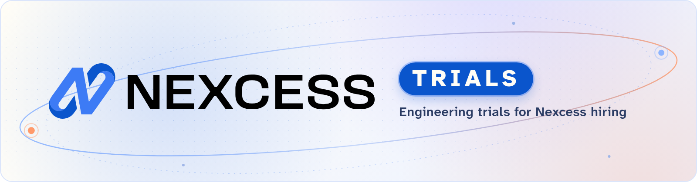

<picture>
  <source media="(prefers-color-scheme: dark)" srcset="https://raw.githubusercontent.com/nexcess-trials/.github/main/images/nexcess-trials-banner-dark.png">
  <source media="(prefers-color-scheme: light)" srcset="https://raw.githubusercontent.com/nexcess-trials/.github/main/images/nexcess-trials-banner-light.png">
  
</picture>

# :wave: Hi! We're Nexcess

Nexcess stands behind leading WordPress plugins.

[Give](https://www.nexcess.com/software/give/) | [Kadence](https://www.nexcess.com/software/kadence/) | [LearnDash](https://www.nexcess.com/software/learndash/) | [The Events Calendar](https://www.nexcess.com/software/the-events-calendar/) | [Nexcess Plugin Stack](https://www.nexcess.com/software/)

---

This organization holds the engineering trials we run as part of hiring at Nexcess. Trials live in their own organization so only the people involved in your hiring process can see your trial project.

[See open positions on our careers page.](https://www.nexcess.com/careers/)

Looking for our open source projects? Check out [our main GitHub organization](https://github.com/stellarwp).
