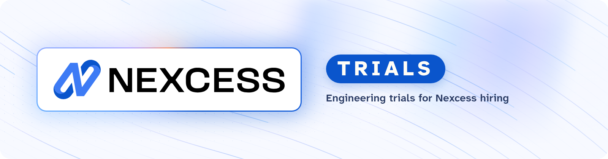

<picture>
  <source media="(prefers-color-scheme: dark)" srcset="https://raw.githubusercontent.com/nexcess-trials/.github/main/images/nexcess-trials-banner-dark-v4.png">
  <source media="(prefers-color-scheme: light)" srcset="https://raw.githubusercontent.com/nexcess-trials/.github/main/images/nexcess-trials-banner-light-v4.png">
  
</picture>

# :wave: Hi! We're Nexcess

Nexcess provides specialty cloud solutions for companies that need control over their cloud environments. Together with Liquid Web and Servers.com, we serve 185k customers on more than 100,000 servers around the world.

### What we build

- **[Nexcess Platform](https://www.nexcess.com/platform/nexcess-platform/):** expert-managed cloud infrastructure with built-in compliance. [Managed Cloud](https://www.nexcess.com/solutions/managed-cloud/) | [VPS](https://www.nexcess.com/vps/) | [Dedicated Servers](https://www.nexcess.com/dedicated-servers/) | [Sites & Stores](https://www.nexcess.com/platform/sites-stores/) | [Disaster Recovery](https://www.nexcess.com/platform/disaster-recovery/)
- **[Servers.com by Nexcess](https://www.servers.com/):** a global IaaS platform for compute, storage and networking, built on single-tenant bare metal with automated cloud tooling.
- **[Liquid Web by Nexcess](https://www.liquidweb.com/):** premium managed hosting, servers and cloud for teams where uptime is non-negotiable.
- **[Nexcess Plugin Stack](https://www.nexcess.com/software/):** we stand behind leading WordPress plugins. [Give](https://www.nexcess.com/software/give/) | [Kadence](https://www.nexcess.com/software/kadence/) | [LearnDash](https://www.nexcess.com/software/learndash/) | [The Events Calendar](https://www.nexcess.com/software/the-events-calendar/)

---

This organization holds the engineering trials we run as part of hiring at Nexcess. Trials live in their own organization so only the people involved in your hiring process can see your trial project.

[See open positions on our careers page.](https://www.nexcess.com/careers/)

Looking for our open source projects? Check out [our main GitHub organization](https://github.com/stellarwp).
